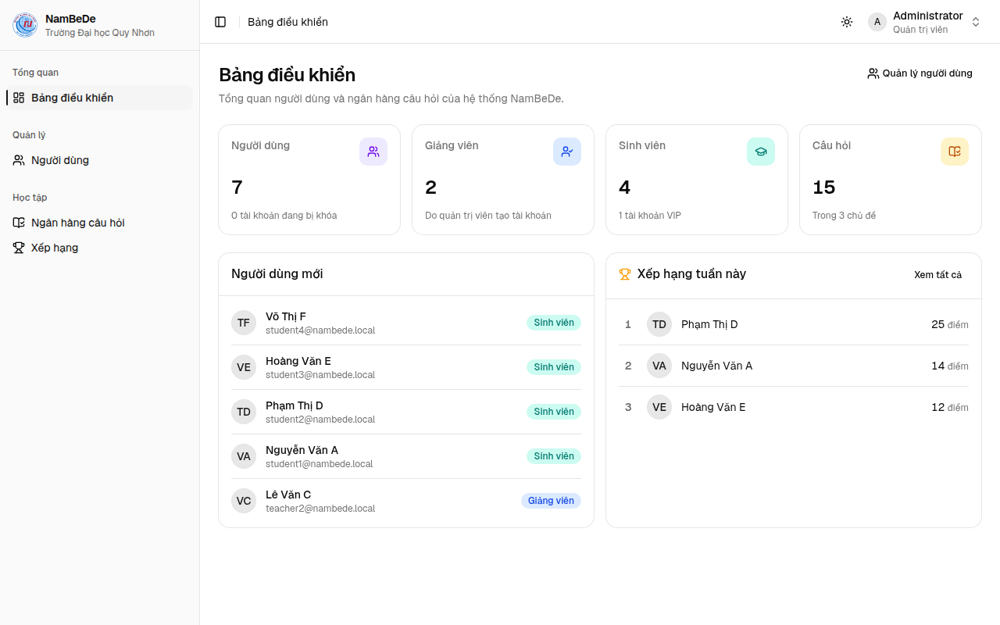
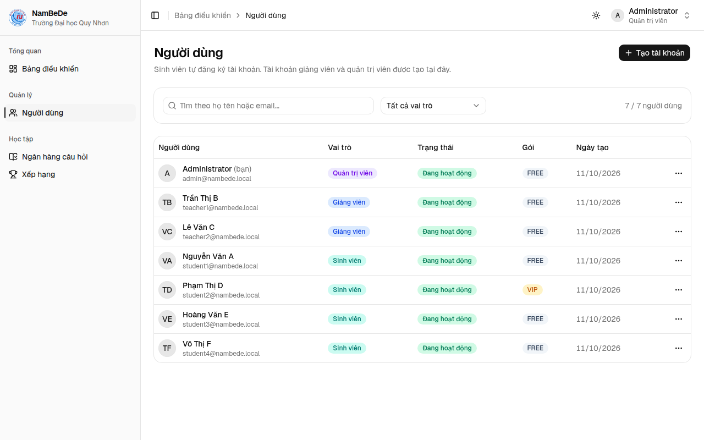
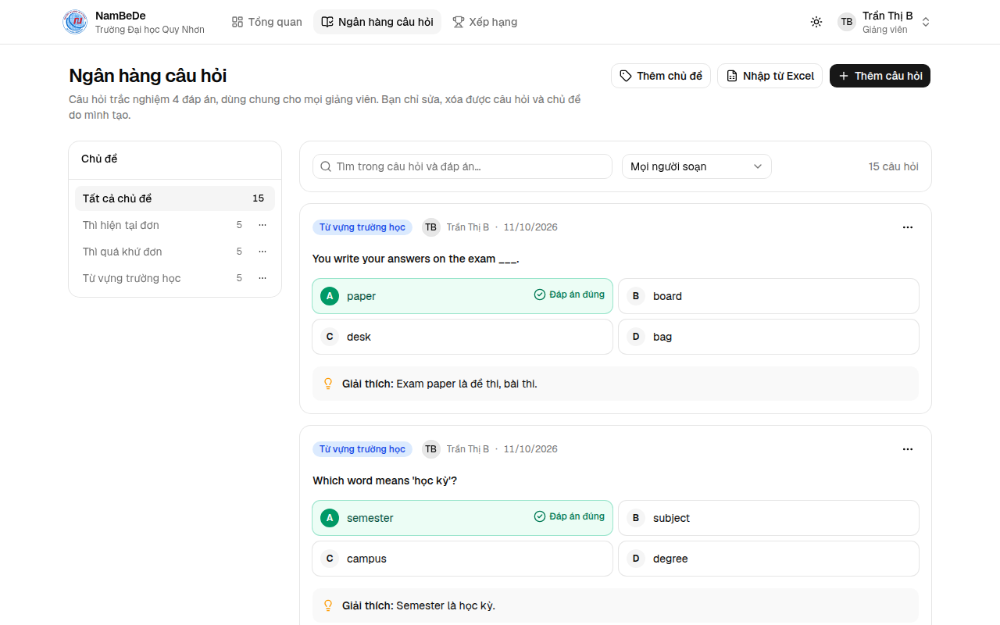
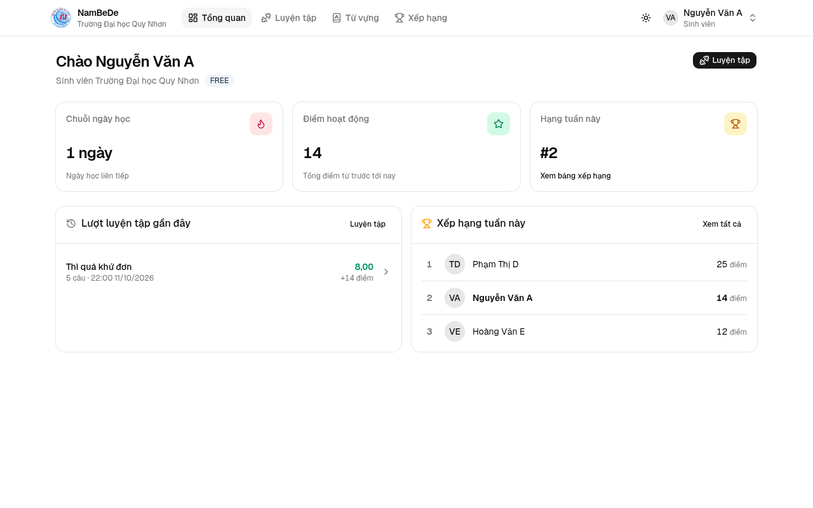
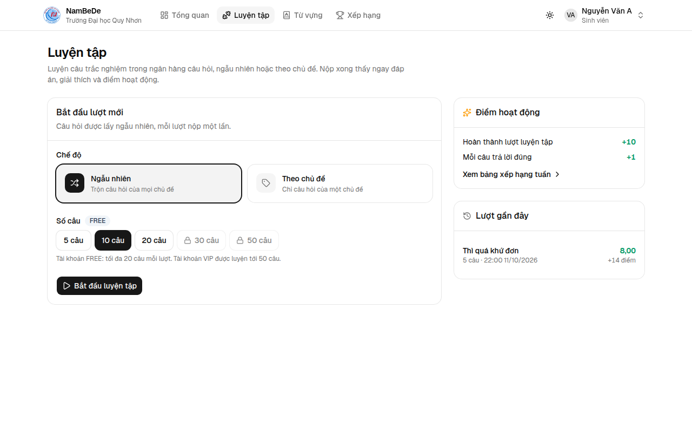
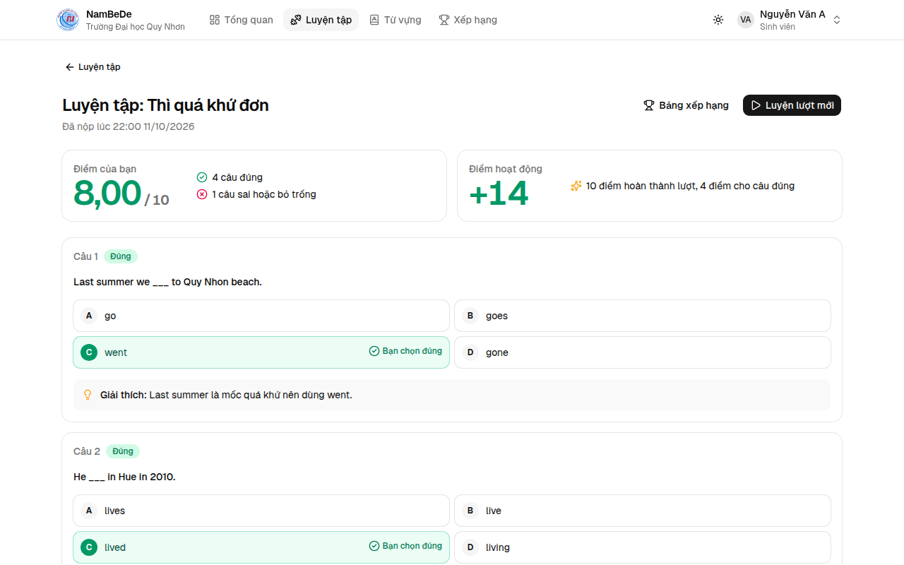
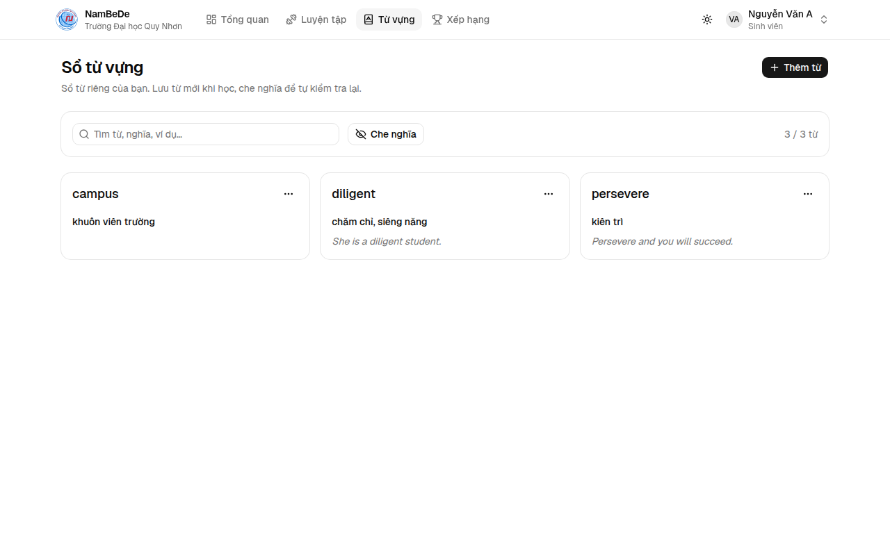
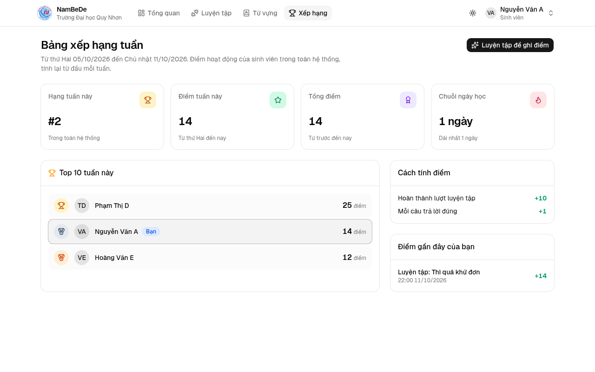

# Hướng dẫn NamBeDe (bản giữa kỳ)

NamBeDe là hệ thống học tập cho sinh viên Trường Đại học Quy Nhơn, xây dựng theo kiến trúc **SOA (Service-Oriented Architecture)**. Bản giữa kỳ gồm phần Python của hệ thống, **API Gateway** và **Learning Service** viết bằng FastAPI, cùng **Auth Service** (Spring Boot) để đăng nhập và cấp JWT, và **giao diện web** (React) cho đúng các chức năng đó: giảng viên soạn ngân hàng câu hỏi, sinh viên luyện tập, ôn từ vựng, giữ chuỗi ngày học và thi đua trên bảng xếp hạng tuần.

Tài liệu này hướng dẫn chạy, demo trên web và trên Swagger, và kiểm thử. Danh sách API đầy đủ nằm ở [`docs/API.md`](API.md).

## Mục lục

1. [Chức năng](#1-chức-năng)
2. [Kiến trúc](#2-kiến-trúc)
3. [Cài đặt và chạy](#3-cài-đặt-và-chạy)
4. [Vai trò và quyền](#4-vai-trò-và-quyền)
5. [Kịch bản demo trên web](#5-kịch-bản-demo-trên-web)
6. [Kịch bản demo trên Swagger](#6-kịch-bản-demo-trên-swagger)
7. [Demo kiến trúc SOA](#7-demo-kiến-trúc-soa)
8. [Kiểm thử](#8-kiểm-thử)
9. [Cấu trúc thư mục](#9-cấu-trúc-thư-mục)
10. [Xử lý sự cố](#10-xử-lý-sự-cố)

---

## 1. Chức năng

| Vai trò | Làm được gì |
|---|---|
| Quản trị viên | Tạo tài khoản giảng viên, admin; khóa, mở khóa, xóa tài khoản, đổi vai trò; chuyển sinh viên giữa gói FREE và VIP; sửa, xóa mọi chủ đề và câu hỏi; xem bảng xếp hạng |
| Giảng viên | Soạn chủ đề và câu hỏi trắc nghiệm trong ngân hàng dùng chung; nhập câu hỏi từ Excel / CSV (xem trước, báo lỗi từng dòng); xem bảng xếp hạng |
| Sinh viên | Tự đăng ký; luyện tập ngẫu nhiên hoặc theo chủ đề (FREE 20 câu, VIP 50 câu mỗi lượt) và xem ngay điểm, đáp án, giải thích; sổ từ vựng riêng; chuỗi ngày học, điểm hoạt động, bảng xếp hạng tuần; tổng quan gộp dữ liệu từ hai service |
| Mọi người | Đổi họ tên, đổi mật khẩu của mình; giao diện sáng / tối, dùng tốt trên điện thoại |

---

## 2. Kiến trúc

```text
        Web (React)              Swagger, curl, script
  http://nambede.dev.localhost             │
             │                             │
             └─────────┬───────────────────┘
                       ▼
             ┌───────────────────┐
             │  FastAPI Gateway  │  :8000  kiểm tra JWT, định tuyến, gộp dữ liệu (BFF), X-Request-ID
             └─────────┬─────────┘
             ┌─────────┴──────────┐
             ▼                    ▼
       Auth Service        Learning Service
       Spring Boot         FastAPI
         :8081               :8084
             │                    │
          auth_db            learning_db
             └── PostgreSQL 17 ───┘
```

| Thành phần | Công nghệ | Cổng | Database | Phụ trách |
|---|---|---|---|---|
| Web | React 19, Vite, Tailwind CSS 4, shadcn/ui; nginx | 80 | | Giao diện cho mọi vai trò |
| Gateway / BFF | FastAPI (Python 3.12) | 8000 | | Điểm vào duy nhất: kiểm tra JWT, định tuyến, gộp dữ liệu dashboard, Swagger chung |
| Learning Service | FastAPI (Python 3.12), SQLAlchemy, Alembic | 8084 | `learning_db` | Chủ đề, ngân hàng câu hỏi, nhập Excel / CSV, luyện tập, từ vựng, streak, điểm, xếp hạng |
| Auth Service | Spring Boot 4 (Java 17) | 8081 | `auth_db` | Người dùng, đăng nhập, JWT, vai trò, trạng thái, gói FREE / VIP |
| PostgreSQL | PostgreSQL 17 | 5432 | 2 database | Một máy chủ, mỗi service một database riêng |

### Nguyên tắc

- **Client chỉ gọi gateway.** Web gọi `/api/...` trên chính domain của nó (nginx chuyển tới gateway), Swagger và curl gọi gateway ở cổng 8000; gateway chuyển tới service phụ trách.
- **Mỗi service một database.** Không service nào đọc bảng của service khác. Cần dữ liệu thì gọi REST API của service sở hữu.
- **REST và JSON** giữa các service, kể cả giữa Spring Boot và FastAPI: mỗi bên không cần biết bên kia viết bằng gì.
- **Một JWT cho tất cả, chỉ một nơi ký.** Auth Service ký token RS256 bằng khóa riêng (tự tạo lần đầu, lưu trong `auth_db`). Gateway và Learning Service kiểm tra bằng khóa công khai lấy ở `GET /.well-known/jwks.json`. Gateway còn hỏi Auth Service phiên còn mở không (lưu đệm 10 giây), nên khóa tài khoản có hiệu lực ngay sau vài giây.
- **Một dạng lỗi:** `{"status", "error", "message", "path"}`. Service không truy cập được thì gateway trả 502.
- **Bản sao câu hỏi.** Khi bắt đầu lượt luyện tập, câu hỏi được chép vào lượt, nên giảng viên sửa ngân hàng sau đó không làm đổi lượt đang làm hay điểm.

### Các luồng chính giữa service

- **Đăng nhập:** client → gateway → Auth Service kiểm tra mật khẩu (bcrypt), ký JWT RS256.
- **Mỗi request có token:** gateway kiểm tra chữ ký bằng khóa công khai (đọc một lần, giữ trong bộ nhớ), hỏi Auth Service phiên còn mở không, rồi chuyển request. Learning Service kiểm tra token lần nữa và kiểm tra vai trò.
- **Luyện tập:** Learning Service hỏi Auth Service `GET /users/{id}/account-type` để biết gói FREE (20 câu) hay VIP (50 câu).
- **Họ tên:** Learning Service lấy họ tên người soạn và người trên bảng xếp hạng từ Auth Service qua `GET /users/lookup`.
- **Dashboard sinh viên:** gateway gọi song song Auth Service và Learning Service rồi gộp thành một kết quả (mẫu BFF).
- **Lần theo một request:** gateway gán mã `X-Request-ID`, mã đi theo mọi lời gọi giữa service và có trên từng dòng log: `docker compose logs | grep <mã>`.

---

## 3. Cài đặt và chạy

### Yêu cầu

- **Docker**: Docker Desktop trên Windows và macOS; Docker Engine có `docker compose` trên Linux. Java, Maven, Node và uv đều chạy bên trong container.
- **Python 3.9 trở lên** cho script dữ liệu demo và kiểm thử toàn hệ thống. macOS và Linux thường có sẵn `python3`; Windows cài từ python.org.
- **make** (macOS, Linux) cho các lệnh tắt; Windows dùng thẳng các lệnh `docker compose` và `py` ở bảng dưới.
- Không bắt buộc, để sửa code: Node 24 (giao diện web có hot reload), `uv` (chạy test Python ngoài Docker).

### Dựng hệ thống

```bash
git clone <địa chỉ repo> nambede
cd nambede
git switch midterm-python
make deploy                   # macOS, Linux: make up rồi make seed
```

Windows (cmd hoặc PowerShell):

```bat
copy .env.example .env
docker compose up -d --build --wait
py scripts\demo_data.py
```

`make up` tạo `.env` từ `.env.example` nếu chưa có (không có bí mật nào phải điền), build và chạy PostgreSQL, Auth Service, Learning Service, gateway, web rồi chờ tất cả healthy; `make seed` tạo dữ liệu demo. Xong thì mở **http://nambede.dev.localhost**. Lần đầu mất vài phút để tải Maven và thư viện; Auth Service chạy test khi build (`SKIP_TESTS=true` trong `.env` để bỏ qua). Chạy lại bao nhiêu lần cũng được: image đã build thì dùng lại, dữ liệu đã có thì giữ nguyên.

| macOS, Linux | Windows | Làm gì |
|---|---|---|
| `make deploy` | hai lệnh dưới | Dựng toàn bộ: hệ thống và dữ liệu demo |
| `make up` | `docker compose up -d --build --wait` | Build và chạy hệ thống, chờ healthy |
| `make seed` | `py scripts\demo_data.py` | Tạo dữ liệu demo |
| `make test` | (dùng `uv run pytest` trong thư mục service) | Test gateway và Learning Service |
| `make system-test` | `py scripts\system_test.py` | Kiểm thử toàn hệ thống đang chạy |
| `make logs` | `docker compose logs -f --tail=100` | Xem log |
| `make stop` | `docker compose stop` | Dừng các container, giữ dữ liệu |
| `make down` | `docker compose down -v` | Xóa container và toàn bộ dữ liệu |

| Địa chỉ | Dùng để |
|---|---|
| http://nambede.dev.localhost | Trang web (domain `*.localhost` tự trỏ về máy mình, không cần sửa `/etc/hosts`) |
| http://localhost:8000/docs | Swagger chung: menu chọn gateway hoặc từng service, gọi thử qua gateway |
| http://localhost:8081/swagger-ui.html | Swagger riêng của Auth Service, gọi thẳng service (để học, không qua gateway) |
| http://localhost:8084/docs | Swagger riêng của Learning Service, gọi thẳng service |

Tài khoản quản trị viên tạo sẵn: `admin@nambede.local` / `Admin@123` (đổi bằng `ADMIN_EMAIL`, `ADMIN_PASSWORD` trong `.env` **trước** lần chạy đầu tiên).

### Dữ liệu demo

Chạy sau khi hệ thống healthy: `make seed` (Windows: `py scripts\demo_data.py`). Script chỉ dùng thư viện chuẩn của Python và gọi qua gateway như một client, nên dữ liệu đi qua đúng các quy tắc của từng service (câu hỏi được nhập bằng API nhập CSV, điểm do Learning Service tính). Trên hệ thống trống, script tạo:

| Dữ liệu | Chi tiết |
|---|---|
| Giảng viên | `teacher1@nambede.local` (Trần Thị B), `teacher2@nambede.local` (Lê Văn C), mật khẩu `Teacher@123` |
| Sinh viên | `student1@nambede.local` … `student4@nambede.local`, mật khẩu `Student@123`; `student2` là VIP |
| Câu hỏi | 15 câu trong 3 chủ đề: Thì hiện tại đơn, Thì quá khứ đơn, Từ vựng trường học |
| Luyện tập, từ vựng | 3 lượt luyện tập (student1, 2, 3); 4 từ trong sổ của student1 và student2 |
| Xếp hạng tuần | Phạm Thị D 25 điểm, Nguyễn Văn A 14 điểm, Hoàng Văn E 12 điểm |

Cuối cùng script in danh sách tài khoản. Chạy lại không tạo trùng. Gateway ở địa chỉ khác thì thêm `--api http://<máy>:8000/api`; tài khoản admin đọc từ `.env`, hoặc truyền `--admin-email`, `--admin-password`.

---

## 4. Vai trò và quyền

| | Quản trị viên | Giảng viên | Sinh viên |
|---|---|---|---|
| Tạo tài khoản | Mọi vai trò | | Tự đăng ký (luôn là sinh viên) |
| Quản lý người dùng | Khóa, mở khóa, xóa, đổi vai trò, chuyển FREE / VIP | | |
| Chủ đề, ngân hàng câu hỏi | Như giảng viên, và sửa, xóa mọi chủ đề, câu hỏi | Tạo; xem tất cả; sửa, xóa chủ đề và câu mình soạn; nhập từ Excel / CSV | Xem danh sách chủ đề; không xem được câu hỏi (tránh lộ đáp án) |
| Luyện tập, từ vựng, streak, tổng quan | | | Có |
| Bảng xếp hạng tuần | Xem | Xem | Xem, có thêm hạng và điểm của mình |

---

## 5. Kịch bản demo trên web

Web ở **http://nambede.dev.localhost**, đăng nhập bằng tài khoản của dữ liệu demo (mục 3). Web chỉ gọi `/api` trên chính domain của nó; nginx chuyển tiếp tới gateway, nên mọi thao tác trên web đều đi qua gateway như Swagger và curl.


### 5.1 Chuẩn bị trước khi trình bày

1. `make deploy` (Windows: ba lệnh ở mục 3), chờ cả 5 container healthy (`docker compose ps`).
2. Dữ liệu sạch: `make down` rồi `make deploy`. Kiểm thử toàn hệ thống (`make system-test`) tạo thêm tài khoản và chủ đề có đuôi ngẫu nhiên, nên chạy nó **trước** bước này.
3. Mở http://nambede.dev.localhost và http://localhost:8000/docs để chắc cả hai trang hiện đủ. Web chạy được khi không có Internet. Giao diện Swagger chung tải từ CDN (`cdn.jsdelivr.net`) nên cần Internet; không có mạng thì demo API bằng các khối lệnh curl trong `README.md`, hoặc Swagger riêng của Auth Service (http://localhost:8081/swagger-ui.html, đóng gói sẵn).
4. Mở hai cửa sổ trình duyệt (một cửa sổ ẩn danh) để đăng nhập hai vai trò cùng lúc, và một cửa sổ dòng lệnh ở thư mục repo cho mục 7.

### 5.2 Quản trị viên

1. Đăng nhập `admin@nambede.local` / `Admin@123`. **Bảng điều khiển** cho biết số người dùng, giảng viên, sinh viên, số câu trong ngân hàng; người dùng mới và top 5 xếp hạng tuần.
2. **Người dùng → Tạo tài khoản**: tạo giảng viên, ví dụ `gv.moi@nambede.local` / `Teacher@123`, vai trò Giảng viên.
3. Menu ba chấm ở mỗi dòng: **Nâng lên VIP** / **Chuyển về FREE**, **Khóa tài khoản** / **Mở khóa tài khoản**, xóa tài khoản.





### 5.3 Giảng viên

1. Đăng nhập `teacher1@nambede.local` / `Teacher@123`. **Tổng quan**: số chủ đề, số câu trong ngân hàng, số câu mình đã soạn, các chủ đề và top 5 xếp hạng tuần.
2. **Ngân hàng câu hỏi → Thêm chủ đề**, rồi **Thêm câu hỏi**: nội dung, 4 đáp án, chọn đáp án đúng, giải thích. Họ tên người soạn trên mỗi câu do Learning Service hỏi Auth Service.
3. Nhiều câu một lúc: **Nhập từ Excel → Tải file mẫu**, điền câu hỏi (mỗi dòng một câu), chọn chủ đề và file, bấm **Xem trước**. Dòng lỗi được ghi rõ lý do (thiếu đáp án, đáp án đúng không phải A đến D, trùng câu đã có); bấm **Nhập N câu** để lưu các dòng hợp lệ.
4. Đổi họ tên, mật khẩu: menu tài khoản ở góc phải → **Tài khoản của tôi**.



### 5.4 Sinh viên

1. Ở trang đăng nhập bấm **Đăng ký** để tạo tài khoản sinh viên, hoặc dùng `student1@nambede.local` / `Student@123`.
2. **Tổng quan**: chuỗi ngày học, điểm hoạt động và hạng tuần đến từ **một** lần gọi `/api/dashboard/student`, gateway gộp Auth Service và Learning Service (mẫu BFF); bên dưới là các lượt luyện tập gần đây và top 5 tuần này.
3. **Luyện tập**: chọn Ngẫu nhiên hoặc Theo chủ đề và số câu, bấm **Bắt đầu luyện tập**. Tài khoản FREE bị khóa lựa chọn 30 và 50 câu; khi admin nâng lên VIP thì chọn được 50 câu ngay, không cần đăng nhập lại. Chọn đáp án rồi **Nộp bài**: thấy ngay điểm thang 10, đáp án đúng, giải thích và điểm hoạt động nhận được.
4. **Từ vựng**: **Thêm từ** kèm nghĩa và ví dụ; bấm **Che nghĩa** để tự kiểm tra.
5. **Xếp hạng**: top 10 tuần này, hạng và điểm của mình, cách tính điểm, các lần nhận điểm gần đây.

| Hoạt động | Điểm hoạt động |
|---|---|
| Nộp lượt luyện tập | +10 |
| Mỗi câu trả lời đúng | +1 |

Ngày nào sinh viên nộp lượt luyện tập hoặc lưu từ mới thì ngày đó được tính vào chuỗi ngày học (theo giờ Việt Nam). Bảng xếp hạng tính từ thứ Hai đến Chủ nhật.











### 5.5 Bản sao câu hỏi

Điểm này cho thấy lượt luyện tập giữ bản sao câu hỏi, không đọc lại ngân hàng khi chấm:

1. Giảng viên tạo một chủ đề có câu "She ___ to school every day." (đáp án đúng B).
2. Sinh viên bắt đầu lượt luyện tập theo chủ đề đó, chọn B, chưa nộp.
3. Giảng viên vào **Ngân hàng câu hỏi**, sửa câu đó: đổi đáp án đúng sang A.
4. Sinh viên nộp bài: câu đó vẫn được tính **đúng**, vì lượt chấm theo bản sao lúc bắt đầu.

---

## 6. Kịch bản demo trên Swagger

Mọi bước làm trên **Swagger chung** ở http://localhost:8000/docs (cần Internet, xem mục 5.1), mọi lần gọi đều đi qua gateway. Phần này cho thấy API phía sau từng màn hình của web.

### 6.1 Dùng Swagger

1. Menu **Select a definition** ở góc trên: *API Gateway* (health, dashboard), *Auth Service* (đăng nhập, người dùng), *Learning Service* (câu hỏi, luyện tập, từ vựng, xếp hạng).
2. Đăng nhập: chọn *Auth Service* → `POST /auth/login` → **Try it out**, nhập `{"email": "...", "password": "..."}` → **Execute**. Chép giá trị `accessToken` trong kết quả.
3. Bấm **Authorize** (ổ khóa), dán token (không gõ thêm chữ `Bearer`), bấm **Authorize**. Token dùng được cho cả ba mục và còn giữ sau khi tải lại trang.
4. Đổi người dùng: **Authorize** → **Logout**, đăng nhập tài khoản khác rồi **Authorize** lại.

Mỗi kết quả có mục *Response headers*: `x-request-id` là mã của request đó (mục 7).

### 6.2 Giảng viên: ngân hàng câu hỏi

1. Đăng nhập `teacher1@nambede.local` / `Teacher@123`.
2. *Learning Service* → `GET /topics`: 3 chủ đề kèm số câu hỏi và họ tên người tạo (`createdByName`, Learning Service hỏi Auth Service).
3. `POST /topics` tạo chủ đề mới, ví dụ `{"name": "Ôn tập thì hiện tại"}`; ghi lại `id`.
4. `POST /questions` thêm câu, ví dụ `{"topicId": <id>, "content": "She ___ to school every day.", "optionA": "go", "optionB": "goes", "optionC": "gone", "optionD": "going", "correctOption": "B", "explanation": "Chủ ngữ số ít: động từ thêm -es."}`. Gửi `"correctOption": "E"` để thấy lỗi 400.
5. Nhập nhiều câu một lúc: `GET /questions/import/template` → **Download file** để lấy file Excel mẫu. `POST /questions/import` với `topicId`, `dryRun` = `true` và chọn file: từng dòng có danh sách lỗi (`problems`), câu ví dụ đầu bị báo `duplicate` vì trùng câu vừa tạo. Gọi lại với `dryRun` = `false` để lưu các dòng hợp lệ.
6. `GET /questions` lọc theo `topicId`, từ khóa `q`, hoặc `mine=true` (câu của tôi).

### 6.3 Sinh viên: luyện tập, từ vựng, xếp hạng

1. Đăng nhập `student1@nambede.local` / `Student@123` (gói FREE). Hoặc tạo tài khoản mới bằng `POST /auth/register`.
2. *Learning Service* → `GET /questions`: **403**, sinh viên không xem được ngân hàng câu hỏi. `GET /topics` thì được.
3. `GET /practice/limit`: `{"accountType": "FREE", "maxQuestions": 20, ...}`. `POST /practice/start` với `{"mode": "RANDOM", "questionCount": 30}`: **403**.
4. `POST /practice/start` với `{"mode": "TOPIC", "topicId": <id chủ đề>, "questionCount": 5}`: câu hỏi chưa có đáp án (`correctOption` là `null`). Ghi lại `sessionId` và `id` các câu.
5. `POST /practice/submit` với `{"sessionId": <sessionId>, "answers": [{"questionId": <id>, "chosenOption": "B"}]}`: điểm thang 10, đáp án đúng, giải thích, điểm hoạt động nhận được (`pointsEarned`), tổng điểm và chuỗi ngày học.
6. `POST /vocabularies` với `{"word": "curious", "meaning": "tò mò"}`; `GET /vocabularies?q=tò` tìm trong từ và nghĩa. Thêm lại cùng từ: **409**.
7. `GET /streak`, `GET /ranking/weekly`: hạng, điểm tuần, tổng điểm và các lần nhận điểm gần đây.
8. *API Gateway* → `GET /api/dashboard/student`: **một** request, gateway gộp hồ sơ (Auth Service) với streak, điểm, hạng tuần (Learning Service). Đây chính là dữ liệu của trang Tổng quan trên web.

### 6.4 Quản trị viên: FREE / VIP có hiệu lực ngay

Swagger vẫn đăng nhập student1. Ở cửa sổ dòng lệnh, admin nâng student1 lên VIP (trên Swagger thì là `GET /users?role=STUDENT` rồi `PUT /users/{id}/account-type` bằng token của admin):

```bash
G=http://localhost:8000/api
ADMIN=$(curl -s -X POST $G/auth/login -H 'Content-Type: application/json' \
  -d '{"email":"admin@nambede.local","password":"Admin@123"}' | python3 -c 'import sys,json;print(json.load(sys.stdin)["accessToken"])')
SID=$(curl -s "$G/users?role=STUDENT" -H "Authorization: Bearer $ADMIN" \
  | python3 -c 'import sys,json;print([u["id"] for u in json.load(sys.stdin) if u["email"]=="student1@nambede.local"][0])')
curl -s -X PUT $G/users/$SID/account-type -H "Authorization: Bearer $ADMIN" -H 'Content-Type: application/json' \
  -d '{"accountType":"VIP"}'                                       # chuyển về: {"accountType":"FREE"}
```

Quay lại Swagger, student1 gọi lại `GET /practice/limit`: `VIP`, 50 câu, không cần đăng nhập lại, vì Learning Service hỏi Auth Service mỗi lần.

### 6.5 Bản sao câu hỏi

Cùng ý như mục 5.5, làm bằng API:

1. Sinh viên bắt đầu lượt theo chủ đề có câu "She ___ to school every day." (đáp án đúng B), chưa nộp.
2. Giảng viên sửa câu đó bằng `PUT /questions/{id}`: đổi `correctOption` sang `A`.
3. Sinh viên nộp, chọn B: câu đó vẫn **đúng**, điểm 10. Khối lệnh curl thứ ba trong `README.md` làm đúng kịch bản này.

---

## 7. Demo kiến trúc SOA

Các lệnh sau chạy ở thư mục gốc của repo, khi hệ thống đang chạy. Lấy token trước:

```bash
G=http://localhost:8000/api
TOKEN=$(curl -s -X POST $G/auth/login -H 'Content-Type: application/json' \
  -d '{"email":"student2@nambede.local","password":"Student@123"}' | python3 -c 'import sys,json;print(json.load(sys.stdin)["accessToken"])')
```

**Gateway trả 502 khi một service tắt, service còn lại vẫn chạy:**

```bash
docker compose stop learning-service
curl -s $G/topics -H "Authorization: Bearer $TOKEN"
# {"status":502,"error":"Bad Gateway","message":"learning-service is unavailable","path":"/api/topics"}
curl -s $G/users/me -H "Authorization: Bearer $TOKEN"              # vẫn 200: Auth Service không phụ thuộc Learning Service
curl -s $G/dashboard/student -H "Authorization: Bearer $TOKEN"     # vẫn 200: hồ sơ còn, streak, points, weeklyRank là null
docker compose start learning-service
```

Trong lúc Learning Service tắt, trên web của sinh viên:

- Trang **Luyện tập**, **Từ vựng**, **Xếp hạng** báo "Dịch vụ tạm thời không khả dụng. Vui lòng thử lại sau." kèm nút **Thử lại**.
- **Tổng quan** vẫn mở được: ba con số hiện "—" (Chưa có dữ liệu) vì gateway trả `null` cho phần của Learning Service, hồ sơ vẫn đúng.
- Đăng nhập, **Tài khoản của tôi**, trang **Người dùng** của admin vẫn dùng bình thường vì chỉ cần Auth Service.

**Auth Service tắt:** đăng nhập và dashboard trả 502 `"auth-service is unavailable"`. Token đã cấp vẫn dùng được với Learning Service, vì gateway và Learning Service đã giữ khóa công khai trong bộ nhớ (từ request có token đầu tiên sau khi khởi động); dữ liệu vẫn trả về, chỉ thiếu họ tên (`createdByName`, `fullName` là `null`), và gói tài khoản tạm tính FREE (`"accountTypeChecked": false`), kể cả với sinh viên VIP. Bật lại Auth Service thì mọi thứ trở lại bình thường.

```bash
docker compose stop auth-service
curl -s $G/topics -H "Authorization: Bearer $TOKEN"                # vẫn 200, "createdByName": null
curl -s $G/practice/limit -H "Authorization: Bearer $TOKEN"        # student2 là VIP nhưng: {"accountType":"FREE","maxQuestions":20,"accountTypeChecked":false}
docker compose start auth-service                                  # chờ docker compose ps báo healthy
```

**Lần theo một request qua mọi service:** gửi kèm một mã, rồi tìm mã đó trong log của cả hệ thống:

```bash
curl -s -o /dev/null -H "X-Request-ID: demo-1" -H "Authorization: Bearer $TOKEN" $G/topics
docker compose logs | grep demo-1   # gateway, Learning Service, rồi Auth Service (Learning hỏi họ tên): mỗi lời gọi một dòng
```

**Khóa tài khoản có hiệu lực ngay, không chờ token hết hạn:** đăng nhập `student1` trên web. Ở cửa sổ khác, admin khóa `student1` (trang **Người dùng** → **Khóa tài khoản**). Trong vòng 10 giây, thao tác kế tiếp của `student1` bị đưa về trang đăng nhập: gateway hỏi Auth Service `GET /auth/session` và nhận 401 `"Account is locked"`. Làm bằng curl (biến `ADMIN`, `SID` như mục 6.4):

```bash
curl -s -X PUT $G/users/$SID/status -H "Authorization: Bearer $ADMIN" -H 'Content-Type: application/json' \
  -d '{"status":"LOCKED"}'                                         # mở khóa: {"status":"ACTIVE"}
```

**Gọi thẳng service không qua gateway vẫn phải có token:**

```bash
curl -s -o /dev/null -w '%{http_code}\n' http://localhost:8084/topics   # 401
```

---

## 8. Kiểm thử

Không cần cài Java hay uv: các lệnh Java, Python chạy trong container. Test web cần Node 24 trên máy (hoặc xem kết quả của job `web` trên CI).

| Thành phần | Lệnh | Kiểm tra gì |
|---|---|---|
| Gateway (27 test) | `make test` ở thư mục gốc, hoặc `uv run pytest` trong `services/gateway` | Định tuyến, 401, 502, dashboard gộp 2 service và trường hợp Learning Service tắt, Swagger chung, `X-Request-ID`, thu hồi phiên |
| Learning Service (35 test) | `make test`, hoặc `uv run pytest` trong `services/learning-service` | Ngân hàng câu hỏi, nhập Excel / CSV, giới hạn FREE / VIP, chấm luyện tập theo bản sao, streak qua nhiều ngày, xếp hạng tuần, sổ từ vựng |
| Auth Service | trong `services/auth-service`: `docker run --rm -v "$PWD":/workspace -v nambede-m2:/root/.m2 -w /workspace eclipse-temurin:17-jdk-noble ./mvnw -B -ntp verify` (cũng chạy mỗi lần `make up` build lại Auth Service) | JWT RS256, JWK Set, chặn token giả; phiên đăng nhập (`token_version`); quyền theo vai trò; tự đổi họ tên, mật khẩu; chặn đăng nhập sai nhiều lần |
| Web (17 test) | trong `web`: `npm ci`, rồi `npm test && npm run lint && npm run build` | Thông báo lỗi, gắn token, chặn route theo vai trò; kiểu TypeScript, build, lint |
| Toàn hệ thống | `make system-test` khi hệ thống đang chạy (khoảng 15 giây) | Qua gateway như một client: Swagger chung, token và vai trò, họ tên từ Auth Service, FREE / VIP, điểm và streak, dashboard BFF, `X-Request-ID`, khóa tài khoản |

Test của Learning Service dùng SQLite trong bộ nhớ và đồng hồ giả, nên không cần PostgreSQL và kiểm tra được streak qua nhiều ngày. Kiểm tra nhanh bằng curl: các khối lệnh trong `README.md` (mục "Kiểm tra nhanh bằng curl").

### CI trên GitLab

`.gitlab-ci.yml` chạy các lệnh test ở bảng trên mỗi khi push, trong đúng các image mà Dockerfile dùng. Mỗi job chỉ chạy khi thư mục của nó thay đổi:

| Job | Làm gì |
|---|---|
| `auth-service` | `./mvnw verify`: biên dịch, unit test, đóng gói jar |
| `gateway`, `learning-service` | `uv run --locked pytest` với đúng phiên bản thư viện trong `uv.lock` |
| `web` | `npm ci`, lint, unit test, kiểm tra kiểu và build |
| `system-test` | Dựng cả hệ thống bằng Docker-in-Docker (`docker compose up --wait`) rồi chạy `scripts/system_test.py`; log của mọi container ở Artifacts. Cần runner cho phép `privileged` |

Kết quả test hiện trong tab Tests của pipeline. Chạy thử một job trên máy mình (cần Docker): `npx gitlab-ci-local gateway`.

---

## 9. Cấu trúc thư mục

```text
nambede/
├── docker-compose.yml          # postgres, auth-service, learning-service, gateway, web (project nambede-midterm)
├── Makefile                    # lối tắt: deploy, up, seed, test, system-test, logs, stop, down
├── .env.example                # cấu hình mẫu: PostgreSQL, tài khoản admin, cổng web
├── infra/postgres/init/        # tạo auth_db, learning_db khi Postgres chạy lần đầu
├── services/
│   ├── gateway/                # FastAPI: định tuyến, JWT, dashboard BFF, Swagger chung
│   ├── learning-service/       # FastAPI: câu hỏi, luyện tập, từ vựng, streak, xếp hạng
│   └── auth-service/           # Spring Boot: người dùng, đăng nhập, JWT
├── web/                        # React: giao diện web, nginx khi chạy trong Docker
├── scripts/demo_data.py        # tạo dữ liệu demo qua gateway
├── scripts/system_test.py      # kiểm thử toàn hệ thống qua gateway
├── .gitlab-ci.yml              # CI: test từng service và toàn hệ thống
└── docs/                       # tài liệu này, API.md, ảnh màn hình (images/)
```

Mỗi service và `web/` có `README.md` (`readme.md`) riêng mô tả chi tiết và cách chạy test.

---

## 10. Xử lý sự cố

| Hiện tượng | Cách xử lý |
|---|---|
| Swagger chung hiện trang trắng | Giao diện Swagger tải từ `cdn.jsdelivr.net`: kiểm tra Internet. Không có mạng: dùng curl (`README.md`) hoặc Swagger riêng của Auth Service ở http://localhost:8081/swagger-ui.html |
| Bị 401 ngay sau khi admin khóa hay đổi vai trò tài khoản | Đúng thiết kế: token cũ hết dùng được trong vòng 10 giây. Mở khóa rồi đăng nhập lại |
| Mọi API báo 502 `auth-service is unavailable` ngay sau khi khởi động | Gateway hay Learning Service chưa lấy được khóa công khai của Auth Service: chờ Auth Service healthy (`docker compose ps`) rồi thử lại |
| Cổng 80 đã bị dùng | Đặt `WEB_PORT=8080` trong `.env`, chạy lại `make up`, mở http://nambede.dev.localhost:8080 |
| Cổng 8000, 8081, 8084 hoặc 5432 đã bị dùng | Dừng chương trình hoặc container đang dùng cổng (`docker ps` để xem); riêng PostgreSQL có thể đổi `POSTGRES_PORT` trong `.env` |
| Trình duyệt không mở được `nambede.dev.localhost` | Dùng http://localhost (cùng trang web) |
| Web báo "Dịch vụ tạm thời không khả dụng" | Service phía sau đang tắt hoặc đang khởi động: `docker compose ps`, rồi `docker compose start <tên service>` |
| Một service không "healthy" | `docker compose logs <tên service>`; Auth Service (Spring Boot) cần khoảng 1 phút để khởi động lần đầu |
| Một lỗi xảy ra mà không biết ở service nào | Lấy header `X-Request-ID` của câu trả lời (trên web: DevTools, tab Network; trên Swagger: *Response headers*), rồi `docker compose logs \| grep <mã>` |
| Đăng nhập báo tài khoản bị khóa | Admin mở khóa ở trang **Người dùng**, hoặc `PUT /users/{id}/status` với `{"status": "ACTIVE"}` |
| Xóa người dùng xong, log của Auth Service có dòng `RabbitMQ did not take event` | Bình thường ở bản giữa kỳ: chưa có RabbitMQ, sự kiện `user.deleted` nằm chờ trong bảng `outbox_events`, mỗi giờ thử gửi một lần |
| Windows báo không có lệnh `py` | Cài Python từ python.org (chọn "Add python.exe to PATH"), rồi mở lại cửa sổ dòng lệnh |
| Linux: `docker` báo permission denied | Thêm user vào nhóm `docker` (`sudo usermod -aG docker $USER`), đăng xuất rồi đăng nhập lại (hoặc `newgrp docker`) |
| Windows: Docker Desktop báo cần WSL 2 | Mở PowerShell bằng quyền Admin, chạy `wsl --install`, khởi động lại máy rồi mở Docker Desktop |
| Không có lệnh `make` | Windows: dùng các lệnh `docker compose` và `py` ở mục 3; Linux: cài gói `make` |
| Script dữ liệu demo báo "Không gọi được gateway" | Hệ thống chưa chạy hoặc chưa khởi động xong: chờ `docker compose ps` báo healthy; gateway ở máy khác thì thêm `--api` |
| Quên mật khẩu admin | `make down` để làm lại từ đầu (mất toàn bộ dữ liệu), admin được tạo lại từ `.env` |
| Muốn dữ liệu sạch để demo lại | `make down` rồi `make deploy` |
